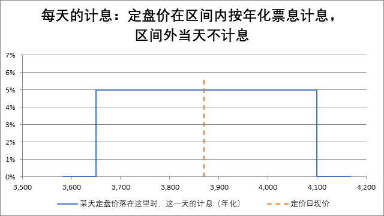
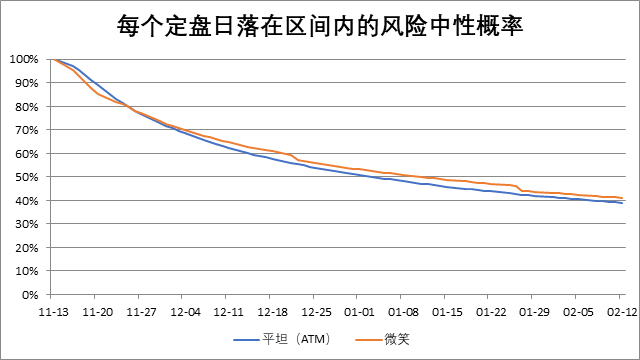

# 黄金区间累积票据定价工作簿

**English:** An Excel workbook that prices a principal-protected gold (XAUUSD) range accrual note and splits it into basic trades: a zero-coupon bond, a strip of daily range digitals, digital calls and call spreads. All pricing is native Excel formulas with a volatility smile. A Python reference model independently checks the workbook to 1e-9 and adds a Monte Carlo distribution. It shows the issuer's take, the breakeven coupon and the client's expected yield.



## 产品

保本票据，期限内每个工作日定盘一次（共 n 次）。定盘价落在区间 [L, U] 内的那天计息，区间外的那天不计息，第二天回到区间内继续计息。到期支付本金和票息：

$$
\text{票息}=N\cdot c\cdot\frac{\text{区间内定盘次数}}{n}\cdot\frac{\text{天数}}{\text{计息基准}}
$$

示例条款：名义本金 100 万美元，92 天，区间 3,650–4,100 美元/盎司（定价日现价 ±6% 取整到 50），年化票息 5%，到期 100% 保本。

## 拆分

| 层 | 内容 | 工作表 |
|---|---|---|
| 1 | 票据 = 保本零息 + 区间累积票息；客户付出、发行方收益拆分、盈亏平衡票息、按目标收益反推的票息、客户期望收益 | 第1层 |
| 2 | 区间累积 = n 份每天的区间数字期权，每份付 1/n 的满额票息（恒等式，不依赖模型） | 第2层 |
| 3 | 区间数字期权 = 数字看涨（下限）− 数字看涨（上限），分平坦和微笑两种模型 | 第3层 |
| 4 | 数字看涨 ≈ 看涨价差 [C(K−ε) − C(K+ε)] / 2ε，整条票息可以用普通期权静态复制 | 第4层 |

票息只取决于每个定盘日的单日分布，与路径无关，所以价格有闭式解：

$$
PV=N\,p\,D+N\,c\,\frac{\text{天数}}{\text{基准}}\,D\cdot\frac1n\sum_{i=1}^{n}Q\left(L\le S_{t_i}\le U\right),\qquad
Q(S_t>K)=N(d_2)-F\sqrt t\,\varphi(d_1)\,\frac{\partial\sigma}{\partial K}
$$

p 是保本比例，D 是 SOFR OIS（加发行方融资利差）贴现因子。微笑由 10D/25D 看跌、ATM、25D/10D 看涨五个点位构成，在行权价上线性插值。



## 工作表

| 表 | 内容 |
|---|---|
| 总览 | 组成树、拆分校验、发行方收益、各种票息、Monte Carlo 分布（建表时算好的静态数值）、两张图 |
| 参数 | 可改的条款（蓝字）：名义本金、期限、计息基准、区间、票息、保本比例；定价日、数据来源、波动率平移、区间模式；发行方融资利差、发行价、认购费、目标收益、价差宽度 ε |
| 行情 | 42 个行情代码：Citi 公式、快照、手工覆盖（F 列）、采用值；推导出的远期、持有成本、利率和波动率期限结构 |
| 定盘 | 每个定盘日的远期、ATM 波动率、五个微笑点位的波动率和行权价 |
| 第1层–第4层 | 见上表 |
| 敏感性 | 以现价为中心的对称区间，半宽 ±3% 到 ±15%：公允价值、发行方收益、盈亏平衡票息、目标票息 |
| 历史 | 按当前相对区间回看过去每天发行的同样票据实际计息多少（示例工作簿不含历史数据） |
| 说明 | 口径、模型、局限 |

## 示例结果

[gold_range_accrual_demo.xlsx](gold_range_accrual_demo.xlsx) 用 [data/gold_ra_demo_20261112.csv](data/gold_ra_demo_20261112.csv) 建成。这份输入按 2026-11-12 收盘水平四舍五入（价格到 1 美元，利率到 0.01%，波动率到 0.1），只作演示：现价 3,870，到期 ATM 波动率 22.70%，美元利率 4.22%，66 次定盘。

| 每 100 万美元名义本金 | 平坦 | 微笑 |
|---|---:|---:|
| 公允价值 | 996,665.62 | 996,883.55 |
| 发行方总收益（发行价 100%，无认购费） | 3,334.38 | 3,116.45（0.31%，年化 1.22%） |
| 平均计息概率 | 57.26% | 58.98% |
| 期望年化票息 | | 2.95% |
| 盈亏平衡票息 | | 7.09% |
| 发行方年化收益 1% 时的票息 | | 5.38% |

Monte Carlo（平坦波动率，20 万条路径）：全部 66 天都在区间内的概率为 3.38%；年化票息的 10%、50%、90% 分位依次为 0.83%、2.95%、4.70%。敏感性：区间从 ±3% 放宽到 ±15%，发行方年化收益从 2.35% 降到 −0.32%，在 ±11% 与 ±12% 之间降到零。

## 使用

需要 Windows 上的 Excel（不用 LET 或动态数组）和 [uv](https://docs.astral.sh/uv/)。脚本带 PEP 723 依赖声明和锁文件，`uv run` 会自动装好 pywin32、numpy。

直接打开示例工作簿即可改参数，Excel 会自动重算。单条行情可以在“行情”表 F 列手工覆盖。

重建工作簿：

```
# 有 Citi Velocity Excel 加载项且已登录（需要你自己的数据权限）
uv run 工具/build_gold_range_accrual.py --date 2026-11-12 --replace

# 没有 Citi：用自己的行情 CSV（列 tag,value,data_date,source；代码同 data/ 里的示例），生成不含历史数据的工作簿
uv run 工具/build_gold_range_accrual.py --share --snapshot data/my_inputs.csv --date 2026-11-12 --out my.xlsx
```

其他参数：`--days`、`--lo`/`--hi`、`--c`、`--spread`（bp）、`--issue`、`--fee`、`--target`，见 `--help`。不加 `--share` 时还要提供 `data/gold_spot_history_<YYYYMMDD>.csv`（列 date, close），或者从 Citi 取。

## 校验

- 建表脚本用独立的 Python 模型 [工具/gold_range_accrual_model.py](工具/gold_range_accrual_model.py) 重算公允价值、发行方收益、平均计息概率、各种票息和敏感性表的一行，相对差超过 1e-9 即失败。
- Monte Carlo 平均计息比例和闭式平坦结果之差超过 4 个标准误即失败（示例为 +0.96）。
- 总览的拆分校验（第 1、2、3 层的恒等式）为 0；第 4 层价差复制与第 3 层的最大差在微笑折点附近约 1e-2（概率单位）。
- [工具/check_gold_range_accrual.py](工具/check_gold_range_accrual.py) 在打开的工作簿里切换定价日、数据来源和区间模式，逐个日期与模型核对（需要 Citi）。

## 口径与局限

- 定盘日为定价日之后到到期日（含）的每个周一至周五，不扣节假日。
- 远期由黄金远期报价给出，持有成本 b = ln(F/S)/t 按期限线性插值；ATM 波动率按总方差线性插值；微笑点位的行权价按远期 Delta（不含期权费）换算，这个惯例是假设。
- 线性插值的微笑在点位处有折点；不含跳空；不计发行方信用风险。
- 风险中性概率不是对实际走势的预测。

本仓库只作模型演示，不构成投资建议。仓库不含任何数据商数据：`data/` 里只有四舍五入的示例输入，用 Citi 行情建的快照、历史 CSV 和工作簿已在 `.gitignore` 中排除。
